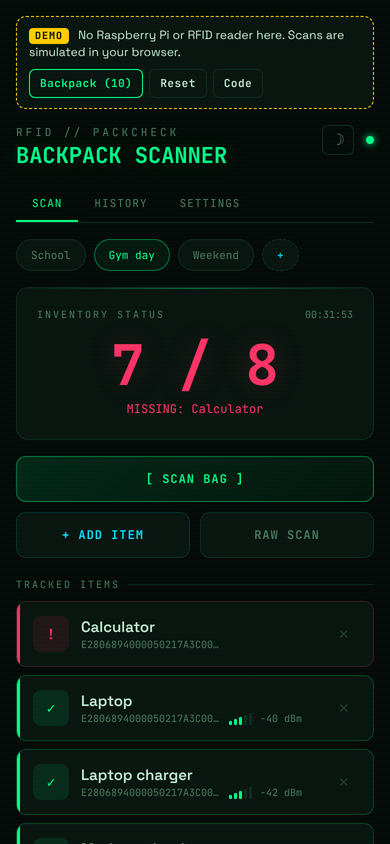
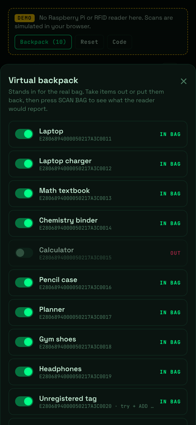
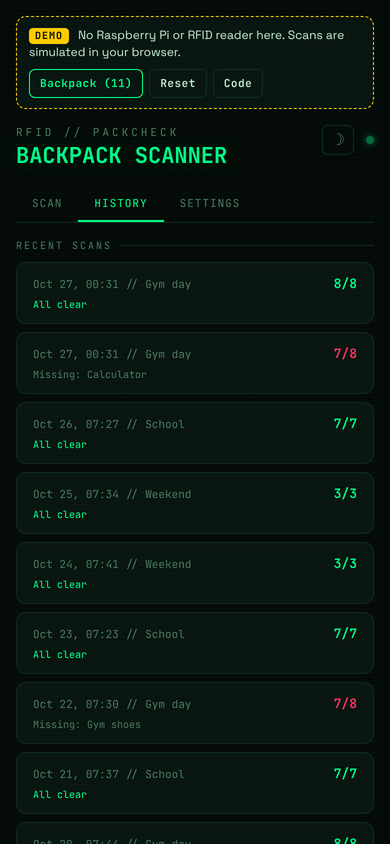

# PackCheck

RFID backpack checker: scans the UHF RFID tags on books/items in your backpack and tells you what's missing before you leave home.

## Live demo
**[Try PackCheck in your browser](https://reptile1234526.github.io/PackCheck/)**. It works on a phone or a computer, and no Raspberry Pi or RFID reader is needed.

The demo is the real PackCheck web app. A simulated reader stands in for the hardware, and it starts with sample items, profiles and scan history. A yellow **DEMO** banner sits at the top of the page.

Things to try:
1. Press **SCAN BAG**. The Calculator was left out of the bag, so it shows up as missing.
2. Open **Backpack** to take items out of the virtual bag or put them back, then scan again.
3. Switch between the **School**, **Gym day** and **Weekend** profiles. Long-press or right-click a profile to edit it.
4. Press **+ ADD ITEM** to register one of the unregistered tags in the bag.
5. Look at the **History** and **Settings** tabs, and try the light theme with the moon button.

Your changes stay in your browser. **Reset** brings back the sample data.

<p>
  
  
  
</p>

## Hardware
- Raspberry Pi 3 Model B
- JENCE J4210u UHF RFID reader (USB serial)

## Tech
- **Python** — reader communication, tag checking, and a Flask web server
- **HTML / CSS / JavaScript** — the web interface (embedded in `app.py`)
- **Fusion 360** — Used to design the 3D-printed case

## Files
- `app.py` — Flask web app (serves the UI and API)
- `reader.py` — J4210u reader interface
- `checker.py` — compares scanned tags to the expected item list
- `config.json` — serial port, baud rate, power, scan duration, items
- `demo/` — builds the live demo from `app.py` into `docs/`, which GitHub Pages serves. Run `python demo/build.py` after changing the web UI.
- `images/` — screenshots used in this README
- `case/` — 3D-printable enclosure (STEP / 3MF files) and the scripts that generate it

## Setup
For the full walkthrough (flashing the Pi, connecting the J4210u, registering items, running on boot, troubleshooting), see **[SETUP.md](SETUP.md)**.

Quick start:
```bash
pip install -r requirements.txt
python app.py
```
Then open `http://<pi-ip>:5000` in a browser.
